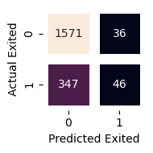
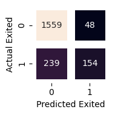
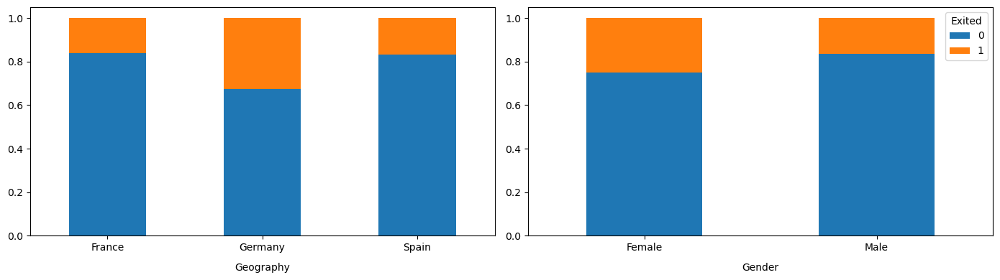
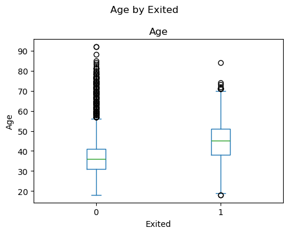
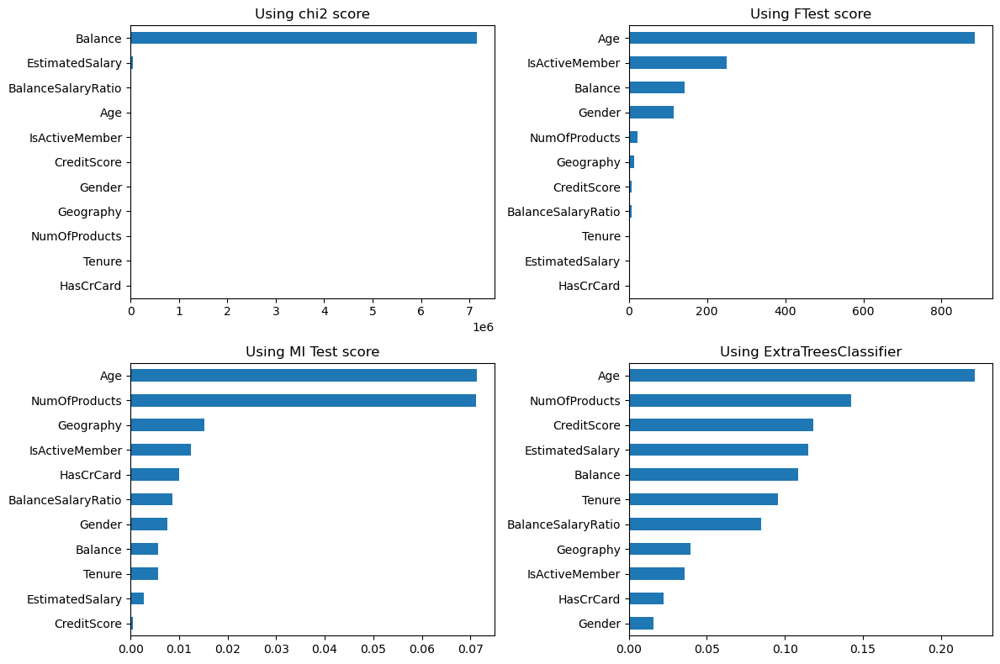
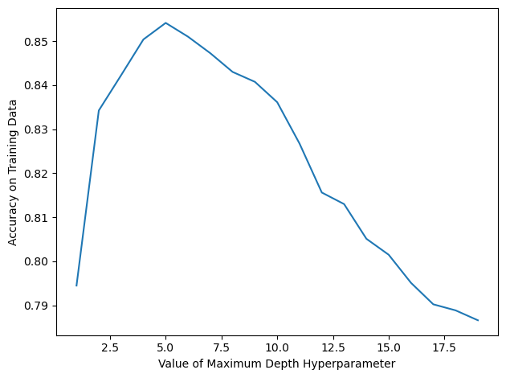

# Bank Customer Churn Prediction

**Python | pandas, scikit-learn, seaborn, Matplotlib | Logistic Regression vs Decision Tree | 10,000 bank customers**

I built this project to predict whether a bank customer will leave the bank, which is known as churn. Retaining existing customers is less costly than acquiring new ones, so predictive models can help banks plan their retention approach and target their resources. The notebook explores the data, prepares the features, and trains, tunes and compares a linear model (Logistic Regression) with a nonlinear one (Decision Tree).

The full write-up is in the [project report (PDF)](report/Bank_Customer_Churn_Report.pdf).

The project was completed during my MSc Computer Science at Queen Mary University of London.

## Key findings

- **The target is imbalanced.** 7,963 customers (**79.6%**) stayed and 2,037 (**20.4%**) left. A model that always predicts "stayed" would already reach 79.6% accuracy, so F1 score, precision and recall are reported as well.
- **Germany has the highest churn rate.** **32.4%** of customers in Germany left, compared with **16.2%** in France and **16.7%** in Spain.
- **Female customers churn more.** The churn rate is **25.1%** for female customers and **16.5%** for male customers.
- **Churned customers are generally older.** Age has the strongest positive correlation with Exited (**0.285**), followed by Balance (**0.119**). IsActiveMember has the strongest negative correlation (**−0.156**).
- **The tuned Decision Tree is the better model.** With max_depth = 5 it outperforms Logistic Regression (C = 0.20) on every test metric and identifies **154** of the 393 churned customers in the test set, compared with **46** for Logistic Regression.
- **Tuning resolved overfitting.** The default Decision Tree scored 1.000 on the training data. Limiting the depth to 5 reduced the training–test accuracy difference from **0.211** to **0.002**.

## Results

Test set results for the tuned models (2,000 customers, 20% of the data):

| Model | Accuracy | F1 score | Precision | Recall |
| --- | --- | --- | --- | --- |
| Logistic Regression (C = 0.20) | 0.808 | 0.194 | 0.561 | 0.117 |
| **Decision Tree (max_depth = 5)** | **0.857** | **0.518** | **0.762** | **0.392** |

<table>
  <tr>
    <td align="center"></td>
    <td align="center"></td>
  </tr>
  <tr>
    <td align="center">Confusion matrix for tuned Logistic Regression</td>
    <td align="center">Confusion matrix for tuned Decision Tree</td>
  </tr>
</table>

Logistic Regression misses 347 of the 393 churned customers, which limits its usefulness for a bank trying to identify customers at risk of leaving. Decision Tree still misses 239 of them, but identifies significantly more churned customers than Logistic Regression.

With default settings, Logistic Regression reached a test accuracy of 0.816 but a recall of only 0.170, while Decision Tree reached 0.789 with a recall of 0.499 but a training accuracy of 1.000. After tuning, the difference between training and test accuracy is near zero for both models: 0.809 vs 0.808 for Logistic Regression and 0.859 vs 0.857 for Decision Tree.

In business terms, the tuned Decision Tree can be used as an early warning system to identify the customers most likely to leave, so the bank can target them with retention offers.

## Charts

**Normalised churn rates by Geography and Gender**

<p align="center"><a href="images/churn-by-geography-gender.png"></a></p>

**Age distribution grouped by Exited (0 = stayed, 1 = churned)**

<p align="center"><a href="images/age-by-churn.png"></a></p>

**Feature selection scores from four methods.** No single feature is consistently ranked as weak across all four methods, so all 11 features were kept.

<p align="center"><a href="images/feature-selection-scores.png"></a></p>

**Cross-validation accuracy across maximum depth for Decision Tree.** Accuracy peaks at depth 5 and then falls as deeper trees begin to overfit.

<p align="center"><a href="images/decision-tree-depth-tuning.png"></a></p>

## How it works

1. **Data quality.** The dataset has 10,000 rows and 14 columns, with no missing values or duplicated rows. RowNumber, CustomerId and Surname are dropped because they carry no information about churn.
2. **Exploratory analysis.** Crosstabs, histograms, density plots and boxplots are used to compare churned and stayed customers. Outliers in Age are real customers, so they are kept.
3. **Feature engineering.** A new feature, BalanceSalaryRatio, is created by dividing Balance by EstimatedSalary (with 1 added to avoid division by zero). Geography and Gender are converted to integer codes.
4. **Feature selection.** A correlation heatmap checks whether any features are highly correlated with each other. SelectKBest with chi-squared, F-test and mutual information, and ExtraTreesClassifier measure how strongly each feature is associated with Exited.
5. **Scaling.** Features are scaled to a 0–1 range with MinMaxScaler. This is mainly important for Logistic Regression, so that variables with larger ranges such as EstimatedSalary do not dominate.
6. **Default models.** The data is split 80/20 into training and test sets. Both models are trained with default settings and checked with 5-fold cross-validation.
7. **Tuning.** C (Logistic Regression) and max_depth (Decision Tree) are chosen with 10-fold cross-validation on the training data.
8. **Evaluation.** The tuned models are compared on the test set with accuracy, F1 score, precision, recall and confusion matrices, and training and test accuracy are compared to check for overfitting.

## Data

| Item | Value |
| --- | --- |
| Source | [Bank Customer Dataset for Churn Prediction](https://www.kaggle.com/datasets/shantanudhakadd/bank-customer-churn-prediction) (Kaggle, Shantanu Dhakad) |
| Size | 10,000 customers, 14 columns |
| Features used | CreditScore, Geography, Gender, Age, Tenure, Balance, NumOfProducts, HasCrCard, IsActiveMember, EstimatedSalary, plus the derived BalanceSalaryRatio |
| Target | Exited: 1 = left the bank, 0 = stayed |
| Licence | Listed on Kaggle as "Other (specified in description)", with no licence terms given, so the CSV is not included in this repository |

## Repository structure

```text
bank-customer-churn-prediction/
├── images/
│   ├── age-by-churn.png
│   ├── churn-by-geography-gender.png
│   ├── confusion-matrix-decision-tree.png
│   ├── confusion-matrix-logistic-regression.png
│   ├── decision-tree-depth-tuning.png
│   └── feature-selection-scores.png
├── report/
│   └── Bank_Customer_Churn_Report.pdf
├── README.md
├── bank_customer_churn_prediction.ipynb
└── requirements.txt
```

## How to run

The notebook was tested with **Python 3.12**.

1. Install the packages: `pip install -r requirements.txt`
2. Download `Churn_Modelling.csv` from [Kaggle](https://www.kaggle.com/datasets/shantanudhakadd/bank-customer-churn-prediction) and put it in the same folder as the notebook.
3. Open `bank_customer_churn_prediction.ipynb` in Jupyter and run all cells.

## Limitations

Both models still struggle with the minority class. Because only 20.4% of customers churned, the models are biased towards the majority class, which results in low recall: even the tuned Decision Tree identifies only 39% of churned customers. As future work, SMOTE could be used to balance the classes, ensemble methods such as Random Forest or Gradient Boosting could be tested, and more composite features, such as combinations of Age and Geography, could be added.

The Decision Tree and ExtraTreesClassifier were trained without a fixed `random_state`, so running the notebook again can change some results slightly. The saved outputs in the notebook match the results in the report.

This is an independent portfolio project and is not connected to, or endorsed by, any bank. It uses a public dataset from Kaggle, which is not included in this repository.
